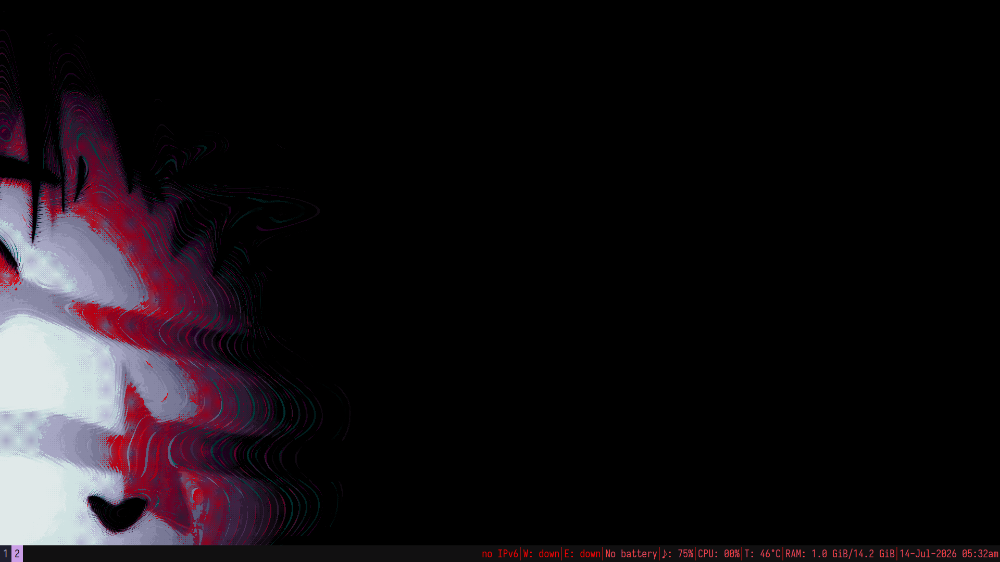

## dots (wayland)

git, bash

Kitty
tmux
vim/nvim

sway
i3status
swaybg

grim
slurp
swappy

wl-copy
wf-recorder --audio="alsa_output.pci-0000_30_00.6.analog-stereo.monitor" -f output.mp4
pipewire | pipewire-pulse | wireplumber | libpulse

#tools
ncdu: disk cleanup
strace: syscall trace
```


